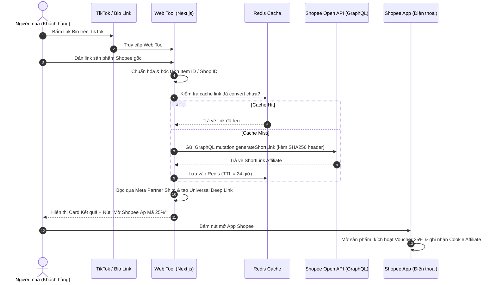

# Tài liệu Kiến trúc Hệ thống (System Architecture)

> **Dự án**: ShopeeLink Pro  
> **Phiên bản**: 1.0.0

---

## 1. Sơ đồ Luồng Dữ liệu (End-to-End Data Flow)



---

## 2. Các Module Kỹ thuật Cốt lõi

### Module 1: Link Expander & Parser (`/lib/shopee/parser.ts`)
* **Nhiệm vụ**:
  * Nhận input tự do từ người dùng (ví dụ: `https://s.shopee.vn/qhxFSbTN2` hoặc đoạn text copy từ app Shopee chứa cả tiêu đề sản phẩm).
  * Trích xuất URL hợp lệ bằng Regex.
  * Nếu là link rút gọn (`s.shopee.vn`, `vn.shp.ee`): Thực hiện một HTTP `HEAD` request (không tải toàn bộ body) để lấy `Location` header của link đích thực sự.
  * Bóc tách các tham số định danh: `item_id`, `shop_id`.

### Module 2: Shopee GraphQL Client & Auth Signer (`/lib/shopee/client.ts`)
* **Thuật toán ký số HMAC-SHA256**:
  ```typescript
  import crypto from 'crypto';

  export function buildShopeeAuth(appId: string, secret: string, payload: string) {
    const timestamp = Math.floor(Date.now() / 1000);
    const signatureBase = `${appId}${timestamp}${payload}${secret}`;
    const signature = crypto.createHash('sha256').update(signatureBase).digest('hex');
    
    return {
      'Content-Type': 'application/json',
      'Authorization': `SHA256 Credential=${appId}, Timestamp=${timestamp}, Signature=${signature}`
    };
  }
  ```

### Module 3: Voucher Injection & Redirect Shim (`/lib/shopee/voucher-shim.ts`)
* **Cơ chế kích hoạt Voucher Meta (`METAPAR...`)**:
  * Voucher giảm 22% - 25% yêu cầu request truy cập xuất phát từ Meta (Facebook/Instagram).
  * Công cụ tạo một endpoint chuyển tiếp nội bộ: `/go/[id]`.
  * Khi người dùng bấm mở app từ endpoint `/go/[id]`, trang đệm sẽ:
    1. Kèm theo HTTP header Referer hoặc chuyển qua Facebook Link Shim: `https://l.facebook.com/l.php?u=<Affiliate_Link>`.
    2. Kích hoạt Custom Scheme mở app Shopee:
       ```
       shopee://open?url=https%3A%2F%2Fshopee.vn%2Fproduct%2F...%3Futm_source%3Dfacebook%26utm_medium%3Dcpc%26utm_campaign%3Dmeta_collab
       ```

### Module 4: High-Performance Bridge Page Route (`/app/go/[slug]/route.ts`)
* **Xử lý WebView TikTok / Facebook**:
  * Khi trang web phát hiện `navigator.userAgent` chứa `TikTok` hoặc `FBAN` (Facebook App):
  * Hiển thị hướng dẫn trực quan:
    * *"Nếu ứng dụng không tự mở: Hãy bấm vào biểu tượng ⋯ ở góc trên bên phải $\rightarrow$ Chọn Mở bằng trình duyệt (Safari / Chrome)"*.

---

## 3. Cấu trúc Thư mục Đề xuất (Next.js 14 App Router)

```
shopee-affiliate-pro/
├── app/
│   ├── api/
│   │   ├── convert/
│   │   │   └── route.ts          # API nhận link, gọi Shopee, trả kết quả
│   │   └── sync-reports/
│   │       └── route.ts          # API đồng bộ doanh thu (Cron job)
│   ├── go/
│   │   └── [slug]/
│   │       └── route.ts          # Endpoint redirect shim mở App Shopee
│   ├── layout.tsx                # Layout chung (Dark mode, SEO meta tags)
│   └── page.tsx                  # Giao diện chính Mobile-First
├── components/
│   ├── ConvertForm.tsx           # Khung nhập link + nút dán nhanh
│   ├── ResultCard.tsx            # Card sản phẩm, mã giảm giá, nút CTA mở app
│   ├── TopVouchers.tsx           # Widget danh sách mã hot trong ngày
│   └── WebViewNotice.tsx         # Cảnh báo hướng dẫn thoát WebView TikTok
├── lib/
│   ├── shopee/
│   │   ├── client.ts             # GraphQL Client & Auth Signer
│   │   ├── parser.ts             # Phân giải và chuẩn hóa link
│   │   └── queries.ts            # Các câu lệnh GraphQL (generateShortLink...)
│   ├── cache.ts                  # Upstash Redis wrapper
│   └── telegram.ts               # Bot thông báo doanh thu
├── public/                       # Assets, icon, hướng dẫn
├── .env.example
├── package.json
└── tailwind.config.js
```
