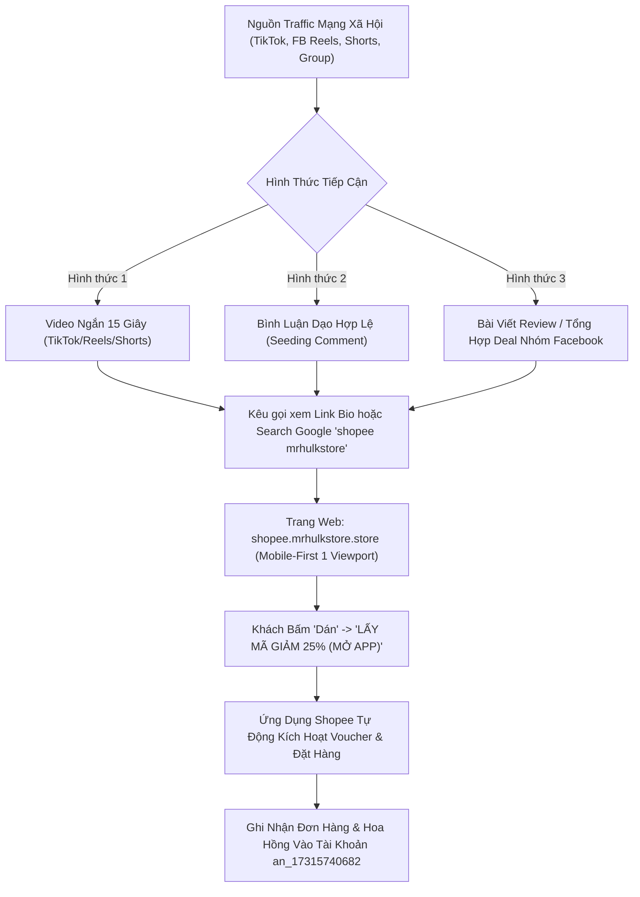

# Cẩm Nang Thực Chiến Kéo Traffic & Seeding Không Bị Ẩn (Traffic & Seeding Playbook)

> **Hệ thống áp dụng**: [ShopeeLink Pro](https://shopee.mrhulkstore.store)  
> **Tên miền chuyển đổi**: `https://shopee.mrhulkstore.store`  
> **Mã đối tác Affiliate**: `an_17315740682`  
> **Mục tiêu**: Hướng dẫn toàn diện cách kéo traffic từ TikTok, Facebook Reels, YouTube Shorts và các hội nhóm mạng xã hội về web để tối đa hóa số lượt chuyển đổi mở App Shopee và thu về hoa hồng bền vững.

---

## 1. Bản Đồ Phễu Chuyển Đổi (Conversion Funnel Architecture)

---

## 2. Quy Tắc Đi Bình Luận Không Bị Ẩn (Anti-Shadowban Protocol)

Các thuật toán kiểm duyệt (Meta Integrity AI, TikTok Monolith, YouTube Perspective) tự động ẩn các bình luận có chứa liên kết URL hoặc lặp lại cùng một chuỗi ký tự. Để bình luận luôn hiển thị 100%, tuân thủ nghiêm ngặt 4 nguyên tắc sau:

### Nguyên tắc 1: Tuyệt đối KHÔNG gõ Link trực tiếp
- ❌ **Sai**: `Vào link shopee.mrhulkstore.store nhận mã nha mọi người` → *Bị bot quét Regex ẩn ngay lập tức trong 0.5 giây.*
- ❌ **Sai**: `shopee . mrhulkstore . store` hoặc `s-h-o-p-e-e` → *Bị bộ lọc NLP phát hiện hành vi cố tình che giấu spam.*
- ✅ **Đúng (Search Query Seed)**: Hướng dẫn người dùng tìm kiếm từ khóa Google:
  > *"Món này tớ vừa dán link qua web đối tác **shopee mrhulkstore** được áp voucher giảm 25% đỡ được gần 150k. Ai mua thì lên Google gõ là ra nha."*

### Nguyên tắc 2: Phễu Bình Luận 2 Bước (Two-Step Reply Hook)
- **Bước 1**: Đăng 1 nhận định khách quan về sản phẩm hoặc giá bán dưới video có nhiều lượt xem:
  > *"Nồi chiên này trên live đang bán 850k, đợt này áp voucher đối tác trên web săn mã chỉ còn 640k freeship luôn. Đừng mua giá gốc phí tiền."*
- **Bước 2**: Khi người xem khác tò mò hỏi lại (*"Săn mã ở đâu thế bạn?", "Xin web với ạ"*), bạn mới trả lời ở comment con:
  > *"Tớ ghim sẵn hướng dẫn ở đầu trang cá nhân tớ rồi á, vào bấm là tự mở app Shopee nhận mã luôn."*
  *(Bình luận được tương tác qua lại sẽ được thuật toán tự động đẩy lên **Top Comment** của video).*

### Nguyên tắc 3: Đa Dạng Hóa Mẫu Câu (Spintax Rule)
Không bao giờ dùng 1 mẫu câu copy-paste cho nhiều bài viết. Hãy xoay vòng các biến thể:
- **Biến thể A**: *"Áo này chất xịn đét, nãy dán link qua trang shopee mrhulkstore áp mã giảm được 75k luôn."*
- **Biến thể B**: *"Đang có đợt mã giảm 25% toàn sàn của bên đối tác shopee mrhulkstore á, bạn nào mua đồ nhớ check trước đỡ tốn tiền."*
- **Biến thể C**: *"Tiếc thế vừa mua xong mới biết web shopee mrhulkstore có mã giảm 200k cho đơn này."*

### Nguyên tắc 4: Tần Suất An Toàn
- Mỗi tài khoản chỉ đi bình luận từ **15 – 25 bài viết mỗi ngày**.
- Khoảng cách giữa 2 lần bình luận tối thiểu từ **3 – 5 phút**.
- Xem video ít nhất 15–30 giây, thả tim trước khi bình luận để thuật toán xác nhận bạn là người dùng thật (High Trust Score).

---

## 3. Top 3 Kịch Bản Video Ngắn 15 Giây Chuyển Đổi Cao (TikTok / Reels / Shorts)

### Kịch bản 1: "Lật Tẩy Bí Mật Mua Hàng Của Dân Săn Sale" (Dạng tò mò)
* **Thời lượng**: 15 giây
* **Hình ảnh video**: Quay màn hình điện thoại (Screen Recording).
  - Giây 0–3: Mở Shopee, vào 1 món đồ hot (tai nghe/váy/giày), giá hiển thị 400.000đ.
  - Giây 4–8: Bấm nút Chia sẻ (↗) → Mở web `shopee.mrhulkstore.store` bấm nút **Dán** → Bấm **LẤY MÃ GIẢM 25%**.
  - Giây 9–12: Màn hình tự nhảy lại vào Shopee App → Giá tụt từ 400.000đ xuống còn 300.000đ tại mục thanh toán!
  - Giây 13–15: Chèn chữ to trên video: *"Link web tớ để ở Bio nhé!"*.
* **Giọng đọc (Voiceover / AI voice)**:
  > *"Tại sao cùng một món đồ mà người khác mua rẻ hơn bạn 100k? Đừng mua giá gốc nữa! Chỉ cần copy link món đồ dán vào web ở bio của mình là tự động có mã giảm 25% mở thẳng App Shopee. Thử ngay đi nhé!"*

---

### Kịch bản 2: "Cảnh Báo Cho Ai Hay Mua Hàng Shopee" (Dạng FOMO - Sợ bỏ lỡ)
* **Thời lượng**: 12–15 giây
* **Hình ảnh video**:
  - Giây 0–2: Màn hình chữ đỏ giật gân: *"DỪNG LẠI NẾU BẠN CHUẨN BỊ MUA SHOPEE!"*.
  - Giây 3–7: Quay thao tác mở web `shopee.mrhulkstore.store` dán link sản phẩm.
  - Giây 8–12: Quay cảnh voucher 25% (tối đa 500k) được kích hoạt thành công trong giỏ hàng.
  - Giây 13–15: Trỏ tay vào nút Link Bio.
* **Giọng đọc**:
  > *"Đừng bấm đặt hàng vội nếu chưa biết mẹo này! Vào link bio của mình, dán đường link món bạn muốn mua vào là có mã giảm 25% độc quyền của Shopee. Áp dụng được cho mọi đơn hàng nhé!"*

---

### Kịch bản 3: "Hướng Dẫn 3 Giây Lấy Mã Bất Kỳ Sản Phẩm Nào" (Dạng Tutorial)
* **Thời lượng**: 15 giây
* **Hình ảnh video**: Chia màn hình làm 3 bước đồ họa nhanh:
  - Bước 1: Icon chia sẻ Shopee (Sao chép liên kết).
  - Bước 2: Web `shopee.mrhulkstore.store` bấm Dán & Lấy mã.
  - Bước 3: Mở lại App và thanh toán.
* **Giọng đọc**:
  > *"Đúng 3 bước để giảm ngay 25% mọi món đồ trên Shopee: Bước 1 copy link sản phẩm. Bước 2 dán vào web ở bio mình. Bước 3 bấm mở app để nhận mã. Lưu video lại khi cần dùng nhé!"*

---

## 4. Quy Trình Vận Hành Hàng Ngày Dành Cho Bạn

1. **Buổi sáng (8h00 - 9h00)**:
   - Đăng 1 video ngắn (theo Kịch bản 1 hoặc 2) lên TikTok, Facebook Reels và YouTube Shorts.
   - Kiểm tra link trên Bio: Đảm bảo link `https://shopee.mrhulkstore.store` luôn bấm được mượt mà.
2. **Buổi trưa (11h30 - 12h30) & Buổi tối (19h30 - 21h30)**:
   - Đây là khung giờ vàng người dùng lướt video và mua sắm online nhiều nhất.
   - Lướt các video review sản phẩm đang lên xu hướng → Bình luận theo **Chiến thuật Gợi ý tìm kiếm Google** hoặc **Phễu 2 bước**.
3. **Cuối ngày (23h00)**:
   - Đăng nhập [affiliate.shopee.vn](https://affiliate.shopee.vn) → Mục **Hiệu quả chuyển đổi** để kiểm tra số lượt click, số đơn hàng phát sinh và số tiền hoa hồng kiếm được trong ngày.
